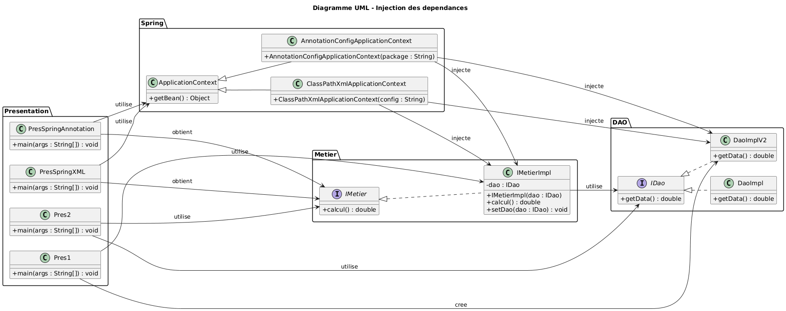
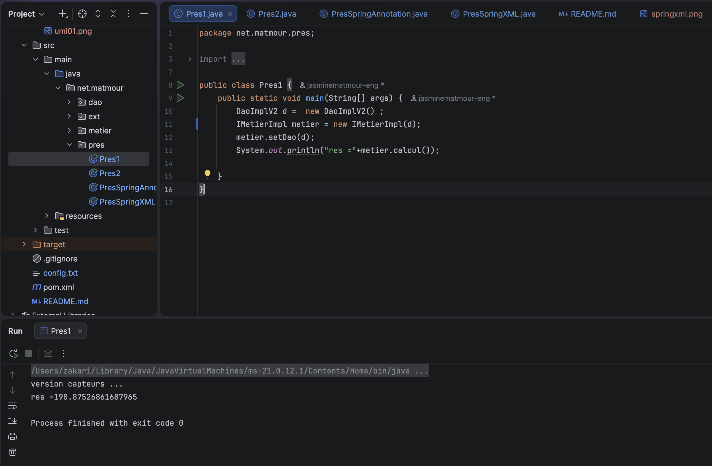
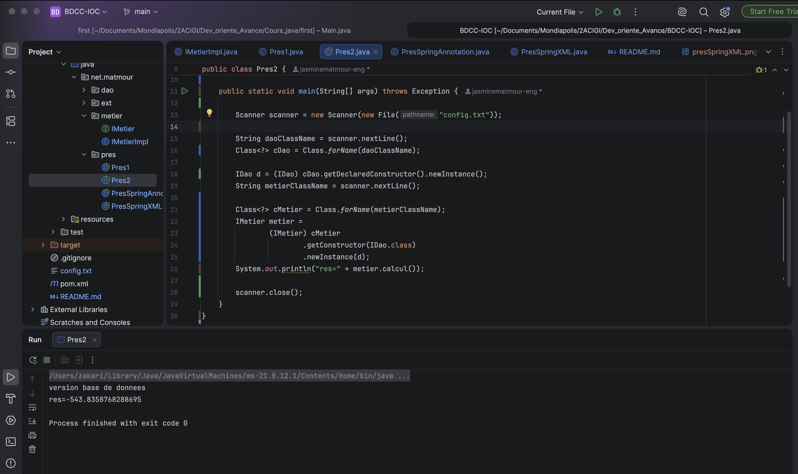
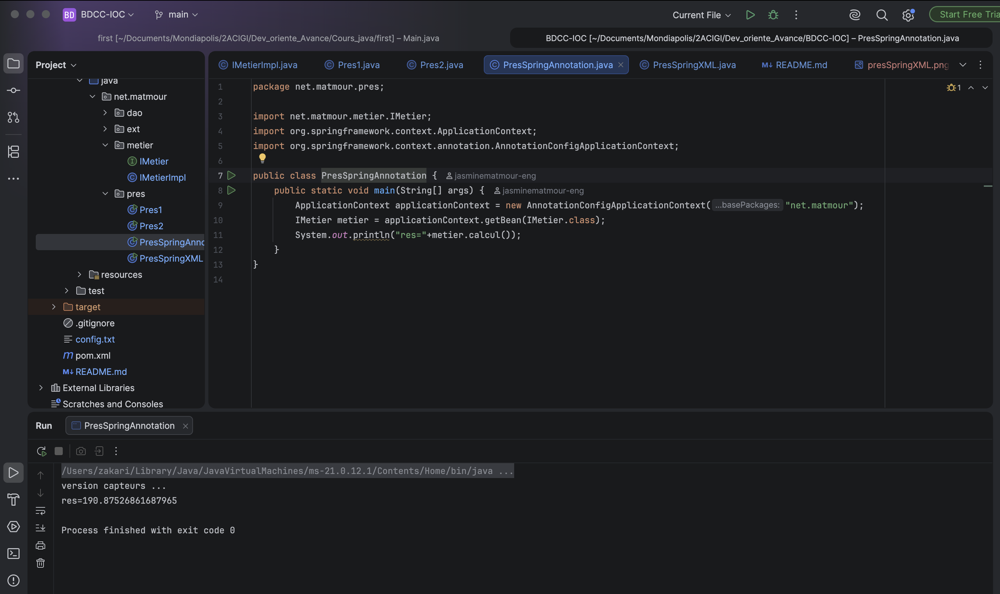
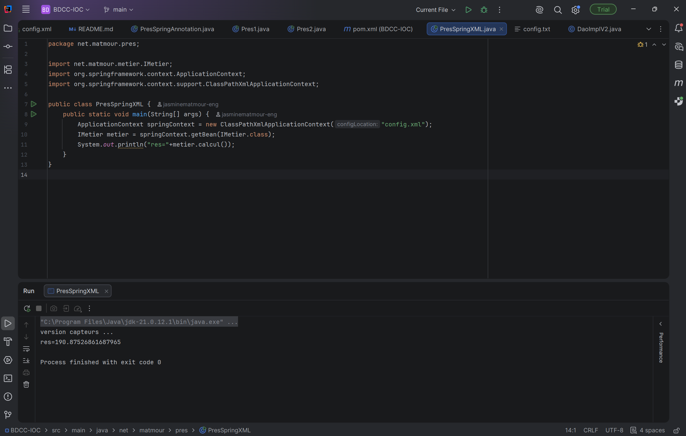

# Projet Java - Injection des dépendances

## Description

Ce projet a pour but d’étudier et d’appliquer le principe de l’**injection des dépendances** en Java.

Il présente différentes approches permettant de gérer les relations entre les composants d’une application Java.

L’objectif de ce TP est de comprendre le fonctionnement de l’injection des dépendances (*Dependency Injection*) ainsi que l’intérêt du faible couplage entre les classes.

Pour cela, nous avons développé une application composée de plusieurs couches, en séparant les interfaces de leurs implémentations. Différentes méthodes d’injection ont ensuite été mises en œuvre :

* Injection par instanciation manuelle
* Injection dynamique grâce à la réflexion Java
* Injection avec Spring à l’aide des annotations
* Injection avec Spring en utilisant un fichier XML

L’architecture du projet repose sur trois parties principales :

* **DAO** : récupération des données
* **Métier** : exécution des traitements et des calculs
* **Présentation** : classes `main` permettant de tester les différentes méthodes

---

# Architecture du projet

La structure générale des packages et des classes est organisée comme suit :

```text
net.matmour
│
├── dao
│   ├── IDao.java
│   └── DaoImpl.java
│
├── ext
│   └── DaoImplV2.java
│
├── metier
│   ├── IMetier.java
│   └── IMetierImpl.java
│
└── pres
    ├── Pres1.java
    ├── Pres2.java
    ├── PresSpringAnnotation.java
    └── PresSpringXML.java
```

---

# Diagramme UML

Le diagramme UML représente les différentes classes du projet, les interfaces utilisées et les relations qui existent entre les composants de l’application.

### Diagramme UML du projet



---

# 🔹 1. Pres1 - Injection manuelle

La classe `Pres1` illustre une première manière de mettre en œuvre l’injection des dépendances dans une application Java.

Elle consiste à instancier directement `DaoImplV2`, puis à transmettre cet objet à la classe `IMetierImpl`.

### Principe

```text
DaoImplV2
    │
    │ injection
    ▼
IMetierImpl
    │
    │ calcul()
    ▼
Résultat
```

Cette approche permet de comprendre simplement le mécanisme d’injection. Cependant, la création des objets et la gestion de leurs dépendances restent à la charge du développeur.

### Capture de Pres1



---

# 2. Pres2 - Injection par réflexion Java

La classe `Pres2` utilise la **réflexion Java** pour créer les objets de manière dynamique.

Les noms des classes à utiliser sont définis dans un fichier de configuration appelé :

```text
config.txt
```

Le programme s’appuie notamment sur les méthodes suivantes :

* `Class.forName()`
* `getConstructor()`
* `newInstance()`
* `getDeclaredMethod()`
* `invoke()`

### Principe

```text
config.txt
    │
    ▼
Nom de la classe DAO
    │
    ▼
Class.forName()
    │
    ▼
Création dynamique de l'objet
    │
    ▼
Injection dans IMetierImpl
```

### Exemple de fichier `config.txt`

```text
net.matmour.ext.DaoImplV2 net.matmour.metier.IMetierImpl
```

L’intérêt de cette méthode est de pouvoir changer les classes utilisées en modifiant le fichier de configuration, sans devoir modifier directement le code de `Pres2`.

### Capture de Pres2



---

# 3. PresSpringAnnotation - Spring avec annotations

La classe `PresSpringAnnotation` s’appuie sur le conteneur Spring pour gérer les composants de l’application à partir des annotations Java.

Le contexte Spring est initialisé avec le code suivant :

```java
ApplicationContext applicationContext =
        new AnnotationConfigApplicationContext("net.matmour");
```

Une fois le contexte créé, l’instance métier est récupérée à partir de son interface :

```java
IMetier metier =
        applicationContext.getBean(IMetier.class);
```

### Principe

```text
AnnotationConfigApplicationContext
              │
              ▼
      Recherche du package
              │
              ▼
       Détection des Beans
              │
              ▼
       Récupération de IMetier
              │
              ▼
            calcul()
```

Spring s’occupe de créer les objets déclarés comme composants et de gérer leurs dépendances. Cette approche évite de devoir instancier manuellement chaque classe dans le programme principal.

### 📷 Capture de PresSpringAnnotation



---

# 4. PresSpringXML - Spring avec XML

La classe `PresSpringXML` utilise également le conteneur Spring, mais les composants et leurs dépendances sont définis dans un fichier XML.

Le fichier de configuration utilisé est :

```text
config.xml
```

Le contexte Spring est créé à l’aide de l’instruction suivante :

```java
ApplicationContext springContext =
        new ClassPathXmlApplicationContext("config.xml");
```

Le bean métier est ensuite obtenu à partir de son interface :

```java
IMetier metier =
        springContext.getBean(IMetier.class);
```

### Principe

```text
config.xml
    │
    ▼
ClassPathXmlApplicationContext
    │
    ▼
Lecture des Beans
    │
    ▼
Création des objets
    │
    ▼
Injection des dépendances
    │
    ▼
Récupération de IMetier
    │
    ▼
calcul()
```

Cette méthode permet de définir les composants et leurs associations dans un fichier externe, ce qui facilite la modification de la configuration sans changer directement les classes Java.

### Capture de PresSpringXML



---

# 🔧 Couche DAO

La couche DAO (*Data Access Object*) est chargée de fournir les données nécessaires aux traitements de l’application.

Elle repose sur l’interface `IDao`, définie comme suit :

```java
public interface IDao {

    double getData();

}
```

Cette interface déclare la méthode qui permet de récupérer une donnée numérique.

Plusieurs classes peuvent fournir une implémentation de cette méthode, notamment `DaoImpl` et `DaoImplV2`.

L’utilisation d’une interface permet à la couche métier de ne pas dépendre directement d’une implémentation particulière.

Elle utilise ainsi le contrat :

```text
IDao
```

plutôt qu’une classe concrète telle que :

```text
DaoImplV2
```

---

# Couche Métier

La couche métier contient l’interface `IMetier` et sa classe d’implémentation `IMetierImpl`.

Elle est responsable des traitements et des calculs effectués à partir des données fournies par la couche DAO.

La classe métier utilise un objet de type `IDao` pour obtenir les informations dont elle a besoin.

Les relations entre les composants peuvent être représentées ainsi :

```text
IMetierImpl
     │
     │ dépend de
     ▼
    IDao
     ▲
     │
     ├──────────────┐
     │              │
  DaoImpl        DaoImplV2
```

Cette organisation permet de remplacer une implémentation DAO par une autre sans modifier nécessairement la logique métier.

---

# Comparaison des différentes méthodes

| Classe                 | Technique utilisée    | Configuration |
| ---------------------- | --------------------- | ------------- |
| `Pres1`                | Injection manuelle    | Code Java     |
| `Pres2`                | Réflexion Java        | `config.txt`  |
| `PresSpringAnnotation` | Injection avec Spring | Annotations   |
| `PresSpringXML`        | Injection avec Spring | `config.xml`  |

---

# Injection des dépendances

Le projet permet d’observer plusieurs façons de gérer les dépendances entre les objets d’une application Java.

### Sans framework

Le développeur crée les objets et établit lui-même les relations entre eux :

```text
new DaoImplV2()
       │
       ▼
new IMetierImpl(dao)
```

### Avec Spring

La création des composants et l’injection de leurs dépendances sont prises en charge par le conteneur Spring.

Cette gestion centralisée réduit le couplage entre les classes et rend les composants plus faciles à remplacer ou à faire évoluer.

---

# Exécution du projet

## Pres1

Lancer la classe :

```text
Pres1
```

Elle permet de tester l’injection des dépendances réalisée directement dans le code Java.

## Pres2

Exécuter la classe :

```text
Pres2
```

Le programme utilise `config.txt` pour charger les classes et créer les objets dynamiquement.

## PresSpringAnnotation

Démarrer la classe :

```text
PresSpringAnnotation
```

Cette classe utilise les annotations Spring pour détecter les composants et gérer leurs dépendances.

## PresSpringXML

Lancer la classe :

```text
PresSpringXML
```

Elle charge les définitions des beans depuis `config.xml` et utilise le conteneur Spring pour créer les objets nécessaires.

---

# Conclusion

Ce projet nous a permis d’explorer plusieurs techniques d’injection des dépendances en Java et de comprendre leur fonctionnement.

Nous avons commencé par la création manuelle des objets, puis utilisé la réflexion Java pour les instancier dynamiquement. Enfin, nous avons découvert comment Spring peut gérer les composants à travers les annotations ou une configuration XML.

La séparation entre les interfaces `IDao` et `IMetier` et leurs implémentations permet de limiter les dépendances directes entre les classes. Elle favorise ainsi une architecture plus souple, modulaire et facile à maintenir.

L’utilisation du conteneur Spring simplifie la création des objets et la gestion de leurs dépendances grâce aux principes d’Inversion of Control (IoC) et d’injection des dépendances.

---

# Auteur

**Projet réalisé par ...**
